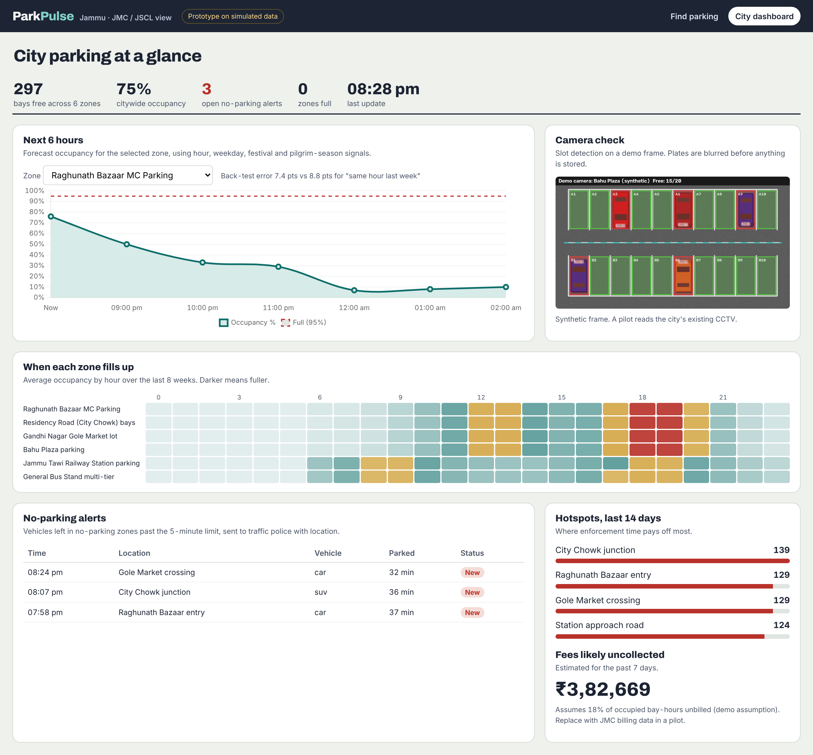
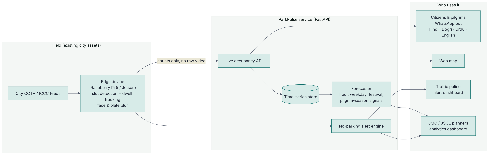

# ParkPulse Jammu

Live parking and congestion intelligence for Jammu, built on the city's existing CCTV cameras.

Built by **Team Byte Bros** for the **Jammu Smart City Hackathon 2026** (Jammu Smart City Limited × LEAD × Jammu Municipal Corporation), category **Digital Governance, Mobility & Smart Infrastructure**, problem statement:

> Use real-time data and technology to optimise parking, manage congestion and discourage illegal parking.



> **Prototype status.** Everything in this repository runs end to end, but it runs on **simulated occupancy data and synthetic camera frames**. No Jammu camera feed, parking survey or billing data has been used. Zone locations are approximate and capacities, fees and the revenue-leakage share are illustrative assumptions. The pilot plan below describes what changes when real data is connected.

## What it does

| For | What they get |
|---|---|
| Citizens and pilgrims | Free-slot counts on a web map and a WhatsApp bot in Hindi, Dogri, Urdu and English. Reply with a number to get directions. No app download. |
| Traffic police | Automatic alerts when a vehicle stays in a no-parking zone past the limit, with location and vehicle class. |
| JMC / JSCL planners | Hour-by-hour fill patterns, a 6-hour occupancy forecast per zone, enforcement hotspots and an estimate of uncollected fees. |

## How it works



1. **Edge vision** (`parkpulse/vision/`). A small device next to an existing camera counts free slots inside slot polygons drawn once at installation. The default backend uses only OpenCV (edge density, texture and colour per slot), so it runs on a Raspberry Pi. An optional YOLO backend (`pip install ultralytics`) assigns detected vehicles to slots for harder camera angles.
2. **Privacy first** (`vision/privacy.py`). Faces and number plates are blurred before a frame is stored or shown. Only counts leave the device in normal operation; plates are read only for an enforcement case.
3. **Illegal parking** (`vision/dwell.py`). A centroid tracker measures how long a vehicle stays inside a no-parking polygon and raises one alert once it passes the limit (default 5 minutes).
4. **Forecasting** (`parkpulse/forecasting.py`). One gradient-boosted model per zone predicts the next hours from hour, weekday, festival windows, a pilgrim-season index and same-hour-yesterday / last-week occupancy. On the simulated history it beats the "same hour last week" baseline (6–9 vs 8–10 percentage points mean absolute error across the six zones).
5. **API and bot** (`parkpulse/app.py`, `parkpulse/bot.py`). FastAPI serves the REST API, the WhatsApp Cloud API webhook and the two web views.

## Run it

Requires Python 3.10+.

```bash
pip install -r requirements.txt
uvicorn parkpulse.app:app --reload
```

Open <http://localhost:8000> for the citizen map and bot preview, and <http://localhost:8000/admin> for the city dashboard. API docs are at `/docs`.

Other entry points:

```bash
python scripts/chat_cli.py              # talk to the bot in the terminal
python scripts/demo_vision.py           # run slot detection + blurring on a synthetic frame
python scripts/calibrate_slots.py frame.jpg slots/cam1.json   # draw slot polygons on a real camera frame
pytest                                  # 11 tests: vision, bot, forecast, API, webhook
```

Docker:

```bash
docker build -t parkpulse . && docker run -p 8000:8000 parkpulse
```

Map tiles come from OpenStreetMap when online. Offline, the map still shows zones, the Tawi river and area names.

## API

| Method | Path | Purpose |
|---|---|---|
| GET | `/api/zones` | Live occupancy for every zone |
| GET | `/api/zones/{id}` | One zone, with 3-hour trend |
| GET | `/api/nearest?lat=&lon=` | Nearest zones with free bays and walking time |
| GET | `/api/forecast/{id}?hours=6` | Occupancy forecast and back-test error |
| GET | `/api/alerts` | Open no-parking alerts |
| GET | `/api/analytics` | Hourly profiles, hotspots, fee-leakage estimate |
| GET | `/api/kpis` | Citywide totals |
| POST | `/api/chat` | Bot reply for the web preview |
| GET/POST | `/api/webhook/whatsapp` | WhatsApp Cloud API verification and inbound messages |
| GET | `/api/vision/demo.png` | Annotated, anonymised demo frame |
| POST | `/api/vision/frame` | Slot detection on an uploaded frame |

## WhatsApp bot

Examples the parser handles:

- `parking near raghunath bazar` (typos are fine)
- `गांधी नगर के पास पार्किंग`
- `بس اسٹینڈ کے قریب پارکنگ`
- `बाहु प्लाज़ा दे कोल पार्किंग कुत्थें ऐ` (Dogri)
- a shared location pin
- `2` after a list, for directions to option 2
- `report car blocking city chowk` / `शिकायत ...`

To go live, register a WhatsApp Business number, set `WHATSAPP_VERIFY_TOKEN`, point the Meta webhook at `/api/webhook/whatsapp`, and add the send call to the Graph API `/messages` endpoint. **The Dogri and Urdu reply templates are a first draft and need review by native speakers before public use.**

## Hackathon submission files

| File | Use |
|---|---|
| `docs/pitch/ParkPulse_Pitch.pdf` | Pitch deck (13 slides) |
| `docs/pitch/ParkPulse_Pitch.pptx` | Editable pitch deck |
| `docs/submission/ParkPulse_Prototype_Screens.pdf` | Prototype screens, wireframes and supporting documents |

## Repository layout

```
parkpulse/
  zones.py            demo zones and no-parking segments (approximate)
  demand_calendar.py  festival windows and pilgrim-season index (illustrative)
  simulator.py        synthetic occupancy and violations
  forecasting.py      per-zone gradient-boosted forecaster
  state.py            live state, analytics, KPIs
  bot.py              multilingual WhatsApp bot logic
  app.py              FastAPI app
  vision/             slot detector, privacy blur, dwell tracker, synthetic frames
web/                  citizen map + bot preview, city dashboard (vendored Leaflet, Chart.js, fonts)
scripts/              demo, CLI chat, slot calibration
slots/                slot polygon files per camera
tests/                pytest suite
docs/                 architecture, screenshots, pitch deck (docs/pitch), submission PDF (docs/submission)
```

## Pilot plan (proposed)

| Weeks | Step |
|---|---|
| 1–2 | Pick 2–3 zones with JMC (e.g. Raghunath Bazaar, Residency Road, Gandhi Nagar). Get read access to the relevant camera feeds, or mount 2–3 low-cost cameras. |
| 3–4 | Draw slot polygons, label a few hundred real frames, choose classical vs YOLO backend per camera, measure accuracy against manual counts. |
| 5–8 | Run the bot with a test group; send alerts to one traffic police unit; review Dogri/Urdu copy with native speakers. |
| 9–12 | Measure search time, illegal-parking incidents and fee collection against the pre-pilot baseline; decide on ward-by-ward rollout. |

**Pilot targets** (to be measured, not results): 25–30% less time spent searching for parking, 20–25% fewer illegal-parking incidents, 15–20% higher fee collection in the pilot zones.

## Known limitations

- All occupancy, violations and fee figures are simulated. Real accuracy must be measured on Jammu camera footage.
- The classical detector is tuned on synthetic top-down frames; real cameras at oblique angles will likely need the YOLO backend or per-camera calibration.
- The plate-blur heuristic finds about 90% of plates on synthetic frames; a trained plate detector should replace it before deployment. Face blurring uses OpenCV's Haar cascade where the OpenCV build includes it.
- Sending WhatsApp messages needs a Business account and access token; the prototype returns the replies it would send.

## License

MIT. Vendored libraries keep their own licenses (Leaflet BSD-2, Chart.js MIT, fonts SIL OFL).
